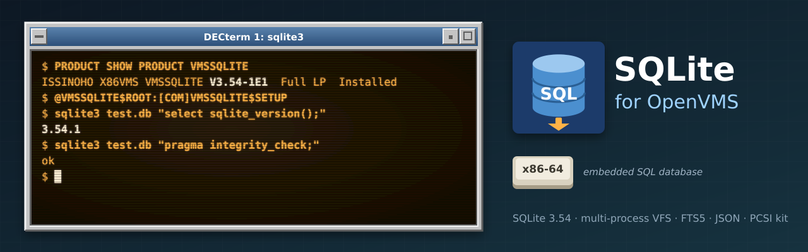

<p align="center">
  
</p>

# SQLite for OpenVMS

[](https://github.com/issinoho/vms-sqlite/releases/latest)
[](https://github.com/issinoho/vms-sqlite/releases)

[](COPYING)

[SQLite](https://sqlite.org) (**3.54.1**) built natively for OpenVMS **x86-64**, with VSI's clang
(64-bit pointers) and VSI C, and with its own OpenVMS file layer (VFS), so that one database can
be shared safely by several processes and accounts. Its first user is
[PHP for OpenVMS](https://github.com/issinoho/vms-php), whose `sqlite3` and `pdo_sqlite` link it
(8.5.12-vms2), running a [phpBB](https://www.phpbb.com/) 3.3 board on SQLite behind
[lighttpd for OpenVMS](https://github.com/issinoho/vms-lighttpd). It belongs to the same family as
[PHP](https://github.com/issinoho/vms-php), [lighttpd](https://github.com/issinoho/vms-lighttpd),
[MariaDB](https://github.com/issinoho/vms-mariadb), [zlib](https://github.com/issinoho/vms-zlib),
[PCRE2](https://github.com/issinoho/vms-pcre2) and the other
[ports for OpenVMS](https://openvms.issinoho.com).

**Status:** released for x86-64 as the PCSI kit `VMSSQLITE` V3.54-1E1
([3.54.1-vms1](https://github.com/issinoho/vms-sqlite/releases/tag/v3.54.1-vms1)), the clang
build; built and tested with both compilers. IA64 is on hold.
- SQLite's multi-process test (`mptest`), a test that stops a writer at random moments
  (STOP/ID), several processes writing one database, and a test across UIC groups all pass,
  with no corruption over repeated runs (`docs/PHASE2.md`).
- A corpus of SQL scripts gives the same results as SQLite on Linux.
- PHP's sqlite3, PDO and pdo_sqlite tests (318) give the same results as on Linux, and a phpBB
  board on SQLite passed its 14-point checklist and a 30-minute load run with four FastCGI
  processes on one database (`docs/PHASE3.md`).

## Why a VFS of its own

SQLite's Unix file layer does its I/O through the C RTL's file descriptors, which are not
coherent between processes on OpenVMS: a process keeps its own copy of blocks it wrote, and
closing a descriptor writes back its own idea of the end of file. This port's VFS
(`overlay/vmsport/os_vms.c`) uses `$QIO` virtual-block I/O on a channel RMS opens (coherent
through XFC), keeps the end of file in the file header, and takes SQLite's locks with the C
RTL's `fcntl()` locks on a companion `<database>-lock` file, which exclude between processes
and across UIC groups. A block cache per file keeps the cost of `$QIO` and ACP calls down. The
design and its measurements are in `docs/DECISIONS.md` (D5, D8-D10).

## Installing

Download the kit from the [latest release](https://github.com/issinoho/vms-sqlite/releases/latest)
(`SHA256SUMS` lists its checksum). A kit downloaded through a non-VMS system loses its record
format: restore it, then install.

```
$ SET FILE/ATTRIBUTE=(RFM:FIX,LRL:8192,MRS:8192,RAT:NONE) ISSINOHO-X86VMS-VMSSQLITE-V0354-1E1-1.PCSI
$ PRODUCT INSTALL VMSSQLITE /PRODUCER=ISSINOHO /SOURCE=dev:[dir]
$ @VMSSQLITE$ROOT:[COM]VMSSQLITE$SETUP          ! the sqlite3 symbol
$ sqlite3 test.db "select sqlite_version();"
```

The kit installs the `sqlite3` shell, `LIBSQLITE3.OLB`, the shareable image `SQLITE3$SHR.EXE`
and the headers under `VMSSQLITE$ROOT`. Add `@SYS$STARTUP:VMSSQLITE$STARTUP` to
`SYSTARTUP_VMS.COM`: it defines `VMSSQLITE$ROOT` and `SQLITE3$SHR`. The library is built with
clang (64-bit pointers); VSI C programs use it compiled `/POINTER_SIZE=64/NAMES=AS_IS`, and
link it statically or against `SQLITE3$SHR` (`[DOC]README.VMS`).

## Notes for OpenVMS

- **Rollback journals only:** no WAL (`PRAGMA journal_mode=WAL` leaves the mode as it was; the
  C RTL's shared mappings are per UIC group, D9) and no loadable extensions.
- **The lock file:** each database has a `<database>-lock` beside it, which SQLite never
  deletes. To delete a database, delete both (and any `-journal`).
- **Access:** every account that writes a database needs write access to the file, its lock
  file and its directory (journals are created there).
- **Diagnostics:** `DEFINE VMSSQLITE_TRACE <directory>` makes each process log its locks, I/O
  and decisions there; `VMSSQLITE_ERRORS` logs only errors, with their VMS status.

## How this repository works

The repository holds **only our changes**: every build starts from the SQLite release pinned in
`upstream.conf` by its SHA3-256 (SQLite does not sign its releases), applies `patches/` and adds
our files from `overlay/`. `tools/fetch.sh` downloads and verifies, `tools/prepare.sh` stages,
`tools/build.sh <node> ALL CLANG|CC` builds on the node (the library, the `sqlite3` shell, the
`SQLITE3$SHR` shareable image and the test programs), `tools/corpus.sh` runs the SQL corpus on
the host and the node, `tools/deploy.sh` copies the install tree to where other ports build
against it, and `tools/kit.sh` makes the PCSI kit. The work is recorded in `docs/` (the plan,
decisions, a porting log and a report per phase).
